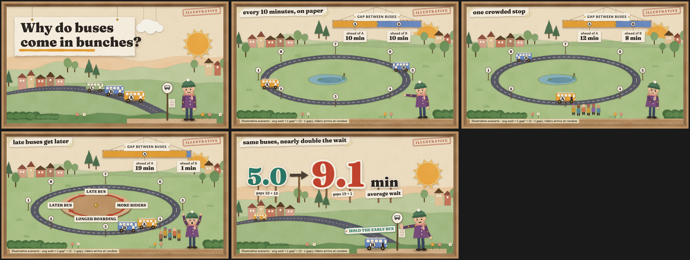

# Showtime: Storytime Presentations for Claude and Codex

Turn a paper, lesson, project, or business decision into a **visual story people can follow**. Showtime packages one reusable skill for Claude and Codex: understand the audience, find the argument, make the difficult idea visible, write notes a presenter can actually say, and inspect the final slides.

It can produce a first deck from one request. “One shot” still includes the agent's own storyboarding, rendering, review, and repair; it is not a guarantee that every deck will need no human revision.

The seven visual worlds below are original examples, not rigid templates. You can choose one, provide your own brand, or ask Claude to develop another direction.



*One five-step example in Paper Diorama. The bus story and numbers are illustrative.*

## Start using it

### Claude Code

Clone this repository, then load its plugin for your session:

```bash
git clone https://github.com/djordjeivanovic11/showtime.git
cd showtime
claude --plugin-dir .
```

In Claude, invoke `/storytime-presentations:storytime-presentations`, or simply ask for a visual presentation. You can also pass the path to a packaged plugin ZIP to `--plugin-dir`. The flag loads the plugin for that session.

### Codex

Add this repository as a Codex plugin marketplace, then install Showtime:

```bash
codex plugin marketplace add djordjeivanovic11/showtime --ref main
codex plugin add storytime-presentations@showtime
```

Start a new Codex chat and ask for a visual presentation, or invoke `$storytime-presentations` explicitly. The same `SKILL.md`, references, visual examples, and export engine are included. To use Showtime as a standalone Codex skill instead of a plugin, ask Codex's `$skill-installer` to install `skills/storytime-presentations` from `djordjeivanovic11/showtime`.

### Claude.ai or Cowork

Claude supports uploading a plugin ZIP through **Customize → Plugins → Add → Upload plugin**. Zip the **contents** of this repository so `.claude-plugin/plugin.json` sits at the ZIP root, then upload that ZIP. The skill and visual references can guide a talk there; the bundled export engine needs a local Node.js and browser runtime, so its PowerPoint workflow has not been verified in Claude.ai or Cowork.

### Give it a useful brief

Provide the source material and, if known, the audience, desired takeaway, speaking time, delivery format, and any brand or accessibility requirements. The skill reads supplied material before asking questions and makes labeled assumptions when details are missing.

For example:

> Use Storytime Presentations to turn this research paper and my notes into an 8-minute talk for classmates who know basic machine learning. Explain the method visually, show which findings are ours, and give me a PowerPoint with plain-language speaker notes and a PDF backup. Please finish a first version in one shot.

> Build a 12-minute executive review from these documents. The audience needs to decide whether to fund the next phase. Use a restrained visual style and put the decision, evidence, and uncertainty on the slides.

> Teach this math idea to first-year students. Begin with a concrete moving picture, let the geometry change step by step, and introduce the equation only after the visual makes sense.

## Seven visual worlds

All seven demos explain the **same fictional bus-bunching story**, with the same five states and illustrative numbers. That makes their differences easy to judge. The [gallery](skills/storytime-presentations/style-lab/gallery.html) runs offline after cloning; each linked contact sheet opens directly on GitHub.

| World | Best fit | Preview |
| --- | --- | --- |
| **Pixel Quest** | Playful research and teaching | [Five-state contact sheet](skills/storytime-presentations/style-lab/candidates/pixel-quest/renders/contact.png) |
| **Paper Diorama** | Education and public talks | [Five-state contact sheet](skills/storytime-presentations/style-lab/candidates/paper-diorama/renders/contact.png) |
| **Signal Line** | Corporate and operations briefings | [Five-state contact sheet](skills/storytime-presentations/style-lab/candidates/signal-line/renders/contact.png) |
| **Editorial Ink** | Policy and evidence stories | [Five-state contact sheet](skills/storytime-presentations/style-lab/candidates/editorial-ink/renders/contact.png) |
| **Blueprint Atlas** | Research and engineering | [Five-state contact sheet](skills/storytime-presentations/style-lab/candidates/blueprint-atlas/renders/contact.png) |
| **Living Proof** | Math and technical teaching | [Five-state contact sheet](skills/storytime-presentations/style-lab/candidates/math-workbench/renders/contact.png) |
| **Cinema** | Large-stage keynotes | [Five-state contact sheet](skills/storytime-presentations/style-lab/candidates/cinema/renders/contact.png) |

The demos are illustrated HTML prototypes with speaker-controlled advances. They are **design references**, not PowerPoint files or drop-in templates for the export engine. The [comparison guide](skills/storytime-presentations/style-lab/README.md) explains what each world does well and what to check before using it.

## How the skill works

1. **Find the audience's question.** Identify what people already know, what they need to understand or decide, and how much time is available.
2. **Build the argument.** Separate sourced claims, the presenter's own work, illustrations, and unresolved points. Keep exact numbers and caveats attached to their sources.
3. **Make a visual mechanism.** Carry a person, object, diagram, or place through the talk so each advance reveals a relationship rather than another block of text.
4. **Write for the speaker.** Notes use natural spoken language, define technical terms, and say when to click.
5. **Verify the deliverable.** Render every slide; check readability, numbers, notes, accessibility, timing, and the actual file in its target app when possible.

The complete instructions are in [`SKILL.md`](skills/storytime-presentations/SKILL.md). The [story principles](skills/storytime-presentations/references/storytime-principles.md), [style guide](skills/storytime-presentations/references/styles.md), and [production checks](skills/storytime-presentations/references/production-and-qa.md) explain the method. Each visual world includes its own design kit and offline demo.

## Formats and requirements

The skill can guide whatever slide format the host's available tools support. This repository also includes an [optional export engine](skills/storytime-presentations/engine/README.md) that builds a layered PowerPoint, PDF, presenter notes, and a single-file offline HTML talk from one `Storytime.deck` source. The engine requires **Node.js 20+**, its pinned npm dependencies, and **Playwright Chromium**. It does not create native Google Slides.

The included engine examples built and passed automated rendering and export checks locally on macOS. The Claude plugin loaded and passed strict validation; the Codex skill passed its validator. **A full deck has not yet been generated through a Claude or Codex session with this public package**, and live PowerPoint Morph motion has not been observed in a slide show. Claude.ai and Cowork behavior has not been tested. Treat the examples as evidence of the tooling, not a promise that a new deck will export or present perfectly without inspection.

PowerPoint text is picture-based by default to preserve appearance. The optional native-text mode requires the fonts on the presentation machine and manual layout review. Always reopen the final file in the application where you will present it.

## License and credit

The original skill, engine, and illustrations are licensed under [Creative Commons Attribution 4.0 International](LICENSE). Credit **Storytime Presentations by Djordje Ivanovic**, link to the license, and indicate changes. Bundled fonts retain their own [Open Font License notices](skills/storytime-presentations/THIRD_PARTY_FONTS.md).

The bus-demo numbers are illustrative. Its suggested bus-holding intervention is a conceptual ending, not a measured result.
